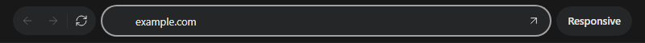

# Browser

`@tacta/browser` supplies remote-browser controls and video/input rendering. Install it
with core. It does not include Chromium, an iframe-based browsing service or an RPC client.



```ts
import "@tacta/browser/register";
import type { BrowserConnector } from "@tacta/browser";

declare const openBrowser: BrowserConnector;
const browser = document.querySelector("tacta-browser-panel")!;
browser.style.height = "480px";
browser.connector = openBrowser;
browser.initialUrl = "https://example.com";
browser.active = true;
```

The connector receives `{ viewport, signal }`. Return a `BrowserSession` with optional
initial `stream: MediaStream`, an async `updates` iterator, and `navigate`, `back`,
`forward`, `reload`, `stop`, `resize`, `input` and `close` methods. Optional `copy` and
`paste` methods bridge remote clipboard state. See the exported
[session types](../../packages/browser/src/types.ts) for the full contract.

Updates carry page state, a new video stream, favicon or cursor. Input frames distinguish
mouse, key, scroll and Unicode text. The UI serializes inputs and commands independently.
Your adapter owns video/WebRTC negotiation, runtime authentication and RPC wire encoding.
Release owned media tracks and remote resources in `close()` and honor the abort signal.

The address bar shows a host at rest and the full URL while editing. Enter navigates;
Escape cancels editing. Bare hosts become HTTPS addresses; HTTP/HTTPS URLs and search
queries follow the source resolver. Back/forward reflect the remote history. The external
arrow opens the address in the user's local browser. `navigate(address)` also exposes
programmatic navigation.

`mode="responsive"` resizes the remote viewport with the panel; `mode="fit"` keeps a
1920×1080 viewport and scales the picture. The underlying `tacta-remote-browser` can be
used without the navigation toolbar. Hidden tabs should remain mounted with `active=false`;
removing a viewer aborts and closes its session. Reconnect after failure is explicit.

[Address/history recording](../media/browser-workflow.mp4).
