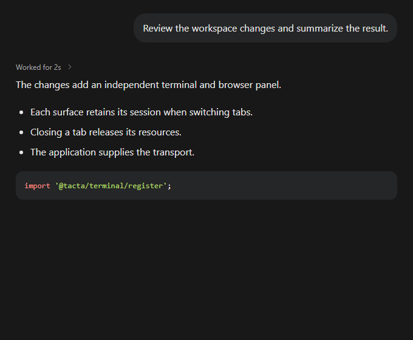
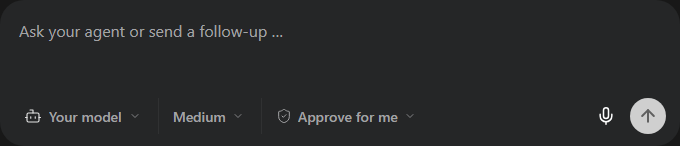
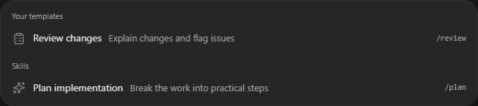
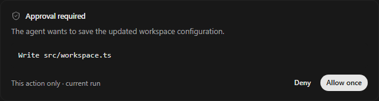

# Chat

`@tacta/chat` composes message history, attachments, tools, approvals and a composer.
Its Tacta dependencies are core, question, voice-input and markdown; see
[installation](../installation.md). Terminal and browser are separate packages.



```ts
import "@tacta/chat/register";
import type { ComposerMessage, Message } from "@tacta/chat";

const history = document.querySelector("tacta-chat-message-list")!;
const composer = document.querySelector("tacta-chat-composer")!;
history.messages = [
  {
    id: "hello",
    role: "human",
    text: "Review my changes.",
    timestamp: new Date().toISOString(),
  },
];
composer.models = [
  {
    id: "model",
    label: "Your model",
    provider: "Custom",
    reasoningEfforts: ["low", "medium", "high"],
    defaultReasoningEffort: "medium",
  },
];
composer.options = { model: "model", reasoning: "medium", access: "default" };
composer.addEventListener("send-message", (event) => {
  const message = (event as CustomEvent<ComposerMessage>).detail;
  // Accept the message in your app, then update history.messages as your agent streams.
});
```

The history retains its streaming scroll behavior, load-older intent, message navigation,
Markdown, tool activity and expandable tool input/results. Supply `Message[]`; update
the array as text or tool states arrive. `presentCall` callbacks let tool components use
application-specific titles. Model/provider grouping and icons also accept callbacks.

## Composer and commands



Enter sends; Shift+Enter inserts a line break. Attachments arrive through files-selected
and attachments-change events. The host owns uploads and sets `uploadingAttachments`.
`running`, `stopping`, `stopDisabled` and `queuedMessages` drive run/queue controls.
`optionsDisabled` can disable model/access options independently from typing.

```ts
composer.commands = [
  {
    command: "review",
    title: "Review changes",
    description: "Explain changes and flag issues",
    kind: "prompt",
    prompt: "Review the code changes.",
  },
];
```

Typing `/` opens the searchable menu; arrows, Enter and Tab choose commands. `prompt` and
`skill` commands expand into their supplied prompt when sending/queuing. `manage` emits
`manage-templates` for application-owned navigation. Loading/error states and refresh
intent are exposed by `commandsLoading`, `commandsError`, `commands-open` and
`commands-refresh`. `commandsBelow` places the menu below the composer when needed.



`send-message` is cancelable: call `event.preventDefault()` synchronously if the host
cannot accept it, preserving draft/attachments. `queue-message` requests queueing;
the application updates the queue after acceptance. `context` changes reset transient
question previews and dictation. Other intents include `stop-run`, `steer-queued`,
`send-queued`, `remove-queued`, `draft-change` and `options-change`.

## Questions and approvals

Set `composer.question` or use [the standalone question package](question.md). Responses
emit `question-response`; the host submits real answers. The Access menu's question
preview is local-only. Approval cards accept `PendingApproval` data and emit
`resolve-approval` with `{ requestId, decision: "allow" | "deny" }`. The host owns
authorization, busy/error state and expiry handling in its backend.



Image attachments support preview, zoom and download. Voice controls require a user click
and microphone permission; see [voice input](voice-input.md). The library does not call
models, execute tools, upload files or persist messages.
