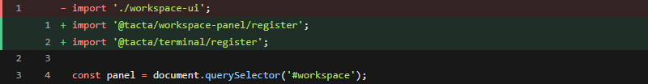

# Code diff

Install `@tacta/code-diff` with core and import `@tacta/code-diff/register`.



```ts
const diff = document.querySelector("tacta-code-diff")!;
diff.path = "workspace.ts";
diff.label = "Workspace changes";
diff.hunks = [
  {
    oldStart: 1,
    newStart: 1,
    lines: [
      { kind: "removed", oldLine: 1, newLine: null, text: "const open = false;" },
      { kind: "added", oldLine: null, newLine: 1, text: "const open = true;" },
    ],
  },
];
```

The component renders supplied hunks with old/new line numbers and addition/removal
styling. Syntax is selected from `path` and language parsers load lazily. It does not
compute diffs, read Git or write files. Supply data from your own diff service.
