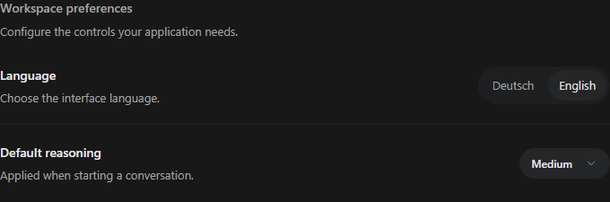

# Form and settings controls

Install `@tacta/controls` with core and import `@tacta/controls/register`.



Available components include text/password inputs, CTA/social-login buttons, native
checkboxes, a keyboard-accessible select, locale switch, pill tabs, page title,
breadcrumbs, key chords, save indicator, settings rows and settings sections. Each class
also has a focused export; `package.json` lists the supported subpaths.

```html
<tacta-settings-section heading="Preferences">
  <tacta-settings-row heading="Reasoning" description="Default effort for a new chat">
    <tacta-app-select slot="control" label="Reasoning"></tacta-app-select>
  </tacta-settings-row>
</tacta-settings-section>
```

```ts
const select = document.querySelector("tacta-app-select")!;
select.options = [
  { value: "medium", label: "Medium" },
  { value: "high", label: "High" },
];
select.value = "medium";
select.addEventListener("value-change", (event) => {
  const value = (event as CustomEvent<string>).detail;
  // Save through your application's settings flow.
});
```

TextInput also emits `value-change` and exposes native validation behavior; PasswordInput
adds visibility control. Inputs/checkboxes intentionally use native inputs in light DOM
for forms, autofill and accessibility. Buttons emit user intent and perform no sign-in API
call. LocaleSwitch emits `locale-change`; the host chooses locale and persistence.
PillTabs emits `tab-change`. SaveIndicator accepts idle/saving/saved/error state.

SettingsRow has `icon`, `heading`, `badge` and `control` slots plus an expanded default
slot. These primitives can compose account, approval, model, plugin or other settings
screens without coupling the library to a particular application's account schema.
