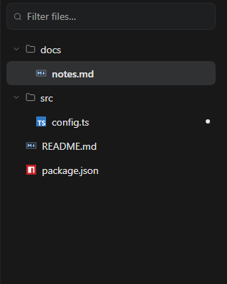

# File explorer and document workspace

Install `@tacta/file-explorer` with core and workspace-panel; import
`@tacta/file-explorer/register`. This does not install document parsing or an editor.



```ts
const explorer = document.querySelector("tacta-document-explorer")!;
explorer.entries = [
  { id: "readme", path: "README.md" },
  { id: "notes", path: "docs/notes.md", dirty: true, deletable: true },
];
explorer.active = "notes";
explorer.addEventListener("document-open", (event) => {
  const id = (event as CustomEvent<string>).detail;
  // Read the file and open/focus its application-owned document.
});
```

The explorer builds a directory tree, filters names/paths, reveals the active entry and
renders loading, dirty and delete states. `document-delete` requests deletion;
directory events let the host load lazy entries. No filesystem operation happens inside
the tree. Supply `state: { collapsed, revealed }` to restore expansion, and handle
`explorer-state-change` to persist it wherever your application chooses.

The package also exposes document tabs, file-type icons, skeletons, path picker,
workspace breadcrumbs, and a source/preview/status toolbar. `document-open` and
`document-close` carry IDs; keyboard tabs support arrows, Home/End and Delete.

```html
<tacta-document-workspace>
  <tacta-markdown-editor></tacta-markdown-editor>
</tacta-document-workspace>
```

The slotted workspace receives `entries`, `tabs`, `active`, `loading`, `explorerWidth`,
`explorerState`, panel controls and a sidebar shortcut. It handles explorer resizing and
responsive layout, and emits `explorer-width-change`, `workspace-refresh` and other
component intent. Add controls through `document-actions` and `explorer-notice` slots.

Applications own tab arrays and retain document elements when switching tabs. Combine
with markdown-document/file-preview as needed. File reads, writes, autosave, revision
conflict handling, deletion confirmation and persistent open-tab state remain host responsibilities.
