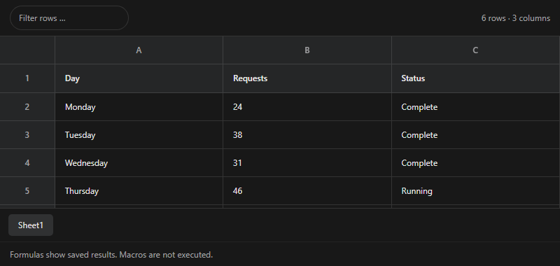

# File previews

Install `@tacta/file-preview` with core and image-editor. Import
`@tacta/file-preview/register`. Parsing libraries belong to this extension and load lazily.



```ts
const preview = document.querySelector("tacta-file-preview")!;
preview.style.height = "420px";
preview.file = {
  path: "activity.csv",
  content: "Day,Requests\nMonday,24",
  encoding: "utf-8",
  size: 26,
};
```

`PreviewFile` contains `path`, `content`, `encoding: "utf-8" | "base64"`, and byte `size`.
Supply `url` for images/audio/video, normally an object URL created with the exported
`fileBlob(file)` helper. The host revokes URLs when no longer needed. `active=false`
pauses media; hiding/offscreen/unmounting also stops playback.

| Format                    | Viewer and behavior                                                                   |
| ------------------------- | ------------------------------------------------------------------------------------- |
| PDF                       | PDF.js canvas and selectable text, page navigation, zoom and fit                      |
| DOCX                      | Sanitized pages in a sandboxed iframe; scripts, links and external resources disabled |
| XLSX/XLS/XLSM/ODS/CSV/TSV | SheetJS worker, sheet selection, filtering and formatted cell values                  |
| Image                     | Image editor with annotation/export controls                                          |
| Audio/video               | Native browser controls                                                               |
| Other files               | Unavailable state; the host can show its download/metadata toolbar                    |

Spreadsheets display up to 500 rows and 50 columns with a truncation notice. Filtering
applies to displayed rows. Saved formula results are shown; macros do not run. Word
layout may differ from Microsoft Word. Plain text and Markdown belong in the separate
[document editor](markdown-document.md).

The PDF worker uses `?url`; spreadsheet workers use `?worker`. Vite supports both.
Configure equivalent asset/worker handling in other bundlers. SheetJS is installed from
its official pinned distribution archive. No file bytes leave the browser through these viewers.
