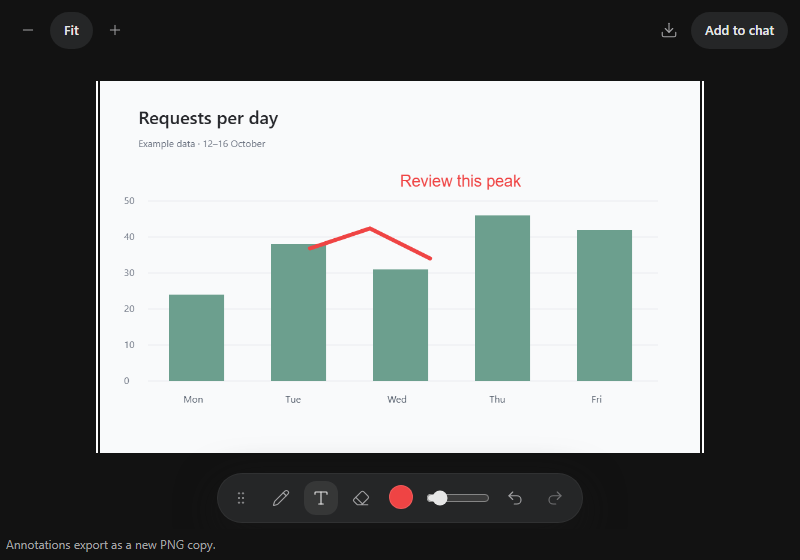

# Image editor

Install `@tacta/image-editor` with core; import `@tacta/image-editor/register`.



```ts
const editor = document.querySelector("tacta-image-editor")!;
editor.style.height = "560px";
editor.src = imageUrl;
editor.filename = "activity.png";
editor.attachable = true;
editor.addEventListener("image-attach", (event) => {
  const file = (event as CustomEvent<File>).detail;
  // Attach this PNG through your application's upload flow.
});
```

Draw freehand strokes, add text, erase annotations, change the palette/hex color and
stroke width. Enter places text, Shift+Enter adds a line and Escape cancels text editing.
Undo/redo supports toolbar controls and Ctrl/Cmd+Z / Ctrl/Cmd+Shift+Z. The toolbar can
be moved by dragging its handle or using arrow keys; Home resets it.

Zoom in/out or Fit changes the viewport. Download PNG exports the original image plus
annotations as a new file. `attachable` exposes Add to chat and emits a PNG `File` instead
of uploading it. Existing image bytes are never overwritten. A new `src` resets editing
history. Remote images need suitable CORS headers to allow canvas export.

Individual canvas, toolbar, text and color components are exported for custom composition.
[Draw/text/undo/export recording](../media/image-annotations.mp4).
