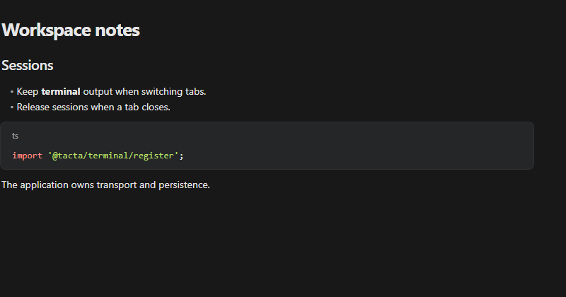

# Markdown and source editor

Install `@tacta/markdown-document` with core and markdown. Import
`@tacta/markdown-document/register`.



```ts
const editor = document.querySelector("tacta-markdown-editor")!;
editor.style.height = "420px";
editor.label = "notes.md";
editor.value = "# Notes\n\nReview the workspace changes.";
editor.live = true;
editor.addEventListener("document-change", (event) => {
  const text = (event as CustomEvent<string>).detail;
  // Debounce/save in the host application, including revision conflict handling.
});
```

CodeMirror supports Markdown and source syntax, history, wrapping, folding, accessible
labels and read-only/disabled states. `source`, `live`, `wrap`, `folding`, `placeholder`
and `label` configure editing. Live preview includes lists, tables and YAML frontmatter;
switching to source exposes the original syntax. Language support loads as needed.
External `value` updates replace document content without becoming user undo entries.

The package also includes SourceDocument, EmptyFile and lower-level live/table/metadata
preview helpers. Removing an editor destroys its view; retain the element to retain
cursor/scroll/undo state across tab switches. No autosave backend, filesystem or local
storage is built into the editor.
