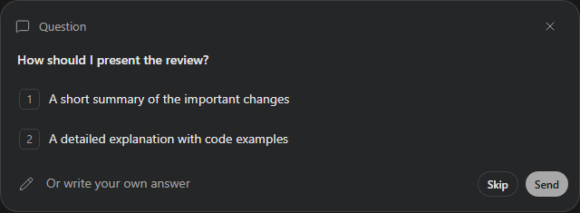

# Question UI

`@tacta/question` depends only on core and Lit. It can be used without installing chat.
Install its local archive together with core; see [installation](../installation.md).



```ts
import "@tacta/question/register";
import type { ComposerQuestionResponse } from "@tacta/question";

const question = document.querySelector("tacta-composer-question")!;
question.question = {
  id: "review",
  prompt: "How should I present the review?",
  options: [
    { id: "brief", label: "A short summary" },
    { id: "detailed", label: "Include code examples" },
  ],
};
question.addEventListener("question-response", (event) => {
  const response = (event as CustomEvent<ComposerQuestionResponse>).detail;
  // Persist the decision, hide the card, or send the response to your agent.
});
```

Choose a numbered radio option or enter a custom answer, then press Send. Enter submits
free text; Shift+Enter inserts a line break. Skip emits `action: "skip"`; close and Escape
emit `action: "dismiss"`. Answer events include `questionId`, `answer`, and an optional
`optionId`. Changing `question` resets selection and text. `disabled` prevents interaction;
`preview` displays a preview badge. `focusAnswer()` moves focus into the card.

The component emits intent and does not remove itself or contact a backend. Chat re-exports
the same class for compatibility. [Recording](../media/question-workflow.mp4).
