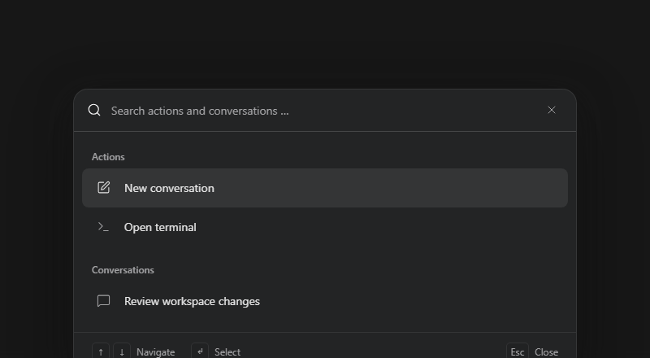

# Search

Install `@tacta/search` with core; import `@tacta/search/register`.



```ts
const search = document.createElement("tacta-search-bar");
search.actions = [
  {
    label: "Open terminal",
    action: "terminal",
    href: "#terminal",
    group: "actions",
    icon: "terminal",
  },
];
search.conversations = [{ id: "review", title: "Review changes", href: "/chat/review" }];
document.body.append(search);
search.addEventListener("close-search", () => search.remove());
```

Search filters supplied actions/conversations and supports keyboard selection, Enter and
Escape. `search-action` carries the selected SearchItem. `close-search` requests dismissal;
the host removes or hides the overlay and restores focus. `current` identifies the active
destination. This component normally covers the viewport; the documentation capture
constrains it to show only the search UI. It does not fetch results or navigate a router.
