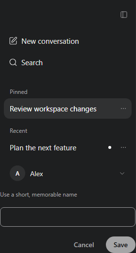

# Sidebar

Install `@tacta/sidebar` with core; import `@tacta/sidebar/register`.



```ts
const sidebar = document.querySelector("tacta-side-bar")!;
sidebar.userName = "Alex";
sidebar.activeId = "review";
sidebar.newChatHref = "/chat/new";
sidebar.items = [
  {
    id: "review",
    title: "Review workspace changes",
    href: "/chat/review",
    pinned: true,
    unread: false,
  },
];
```

Supply navigation through `entries`/`accountEntry`, and branding through the `brand` slot.
Use `collapsed`, `loading`, `hasMore`, profile image properties and `shortcuts` to adapt
the layout. Display entries are data; this package contains no router or pagination API.

Intent events include `navigate`, `select-conversation`, `toggle-pin`,
`rename-conversation` (`{ id, title }`), `delete-conversation`, `load-more`, `sign-out`
and sidebar open/close. The host updates the supplied arrays and performs persistence.
ConversationRow, ProfileMenu, RenameDialog and UserProfile are also exported separately.
