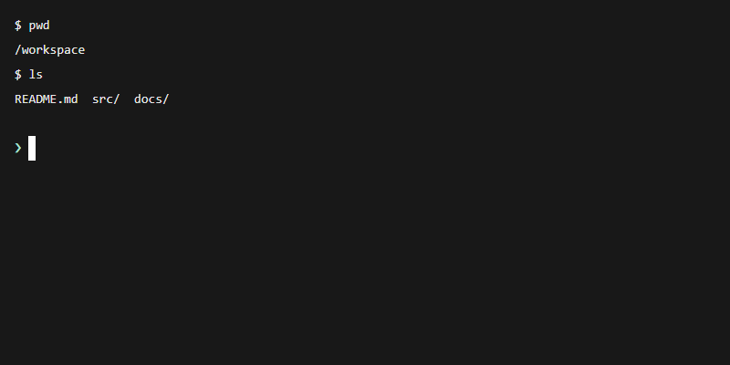

# Terminal

`@tacta/terminal` owns the xterm renderer and search UI. Install it with core. Its xterm
and addon dependencies are confined to this package.



```ts
import "@tacta/terminal/register";
import type { TerminalConnector } from "@tacta/terminal";

// Implement this connector using your existing PTY/WebSocket/RPC transport.
declare const openTerminal: TerminalConnector;
const terminal = document.querySelector("tacta-remote-terminal")!;
terminal.style.height = "400px";
terminal.connector = openTerminal;
terminal.options = { scrollback: 10000, fontSize: 14 };
```

The connector receives `{ cols, rows, sessionId?, signal }` and returns:

```ts
interface TerminalSession {
  frames: AsyncIterable<
    | { type: "ready"; seq?: number }
    | { type: "reset"; seq?: number }
    | { type: "output"; data: string; seq?: number }
    | { type: "exit"; exitCode?: number; seq?: number }
  >;
  write?(data: string): void | Promise<void>;
  resize?(size: { cols: number; rows: number }): void | Promise<void>;
  close(): void | Promise<void>;
}
```

Emit `ready` when the session can accept input. Output rendering applies backpressure to
the async iterator. Optional sequence numbers suppress duplicate/reordered agent frames.
Failed input is never replayed and reconnect is explicit. Closing/removing the element
aborts pending work and closes the session, including a connection that resolves late.
Your adapter must honor `signal` to stop pending network work and its frame iterator.

Set `sessionId` for read-only agent output. This normalizes LF output to terminal CRLF,
disables PTY writes/resizes and emits `terminal-interrupt` with the session ID on Ctrl+C
when `canInterrupt` is true. The host decides how to interrupt the agent.

| Interaction                   | Behavior                                  |
| ----------------------------- | ----------------------------------------- |
| Ctrl+C                        | Interrupt, or copy when text is selected  |
| Ctrl+V / Shift+Insert         | Paste                                     |
| Ctrl+Backspace                | Delete previous word                      |
| Ctrl/Cmd+Shift+F              | Open output search, seeded from selection |
| Enter / Shift+Enter in search | Next / previous match                     |
| Escape                        | Close search and return to the shell      |
| Ctrl/Cmd+click a link         | Open printed URL; touch supports a tap    |

Set `active=false` when hiding a retained terminal. Set `options` before initial mount;
`refreshTheme()` refreshes token-based colors after a theme change. Wide characters use
Unicode 11 widths. [Search screenshot](../media/terminal-search.png),
[typing/search recording](../media/terminal-workflow.mp4).
