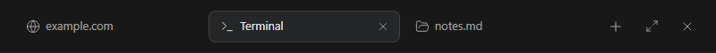

# Workspace panel

Install `@tacta/workspace-panel` with core and import `@tacta/workspace-panel/register`.
This package does not install sidebar, chat, terminal or browser.



```ts
const tabs = document.querySelector("tacta-workspace-tab-bar")!;
tabs.tabs = [{ id: "shell", label: "Terminal", surface: "Terminal", url: "", favicon: "" }];
tabs.active = "shell";
tabs.panelFor = (id) => document.getElementById(id);
tabs.surfaces = [
  { id: "Terminal", label: "Shell", icon: "terminal", key: "t" },
  { id: "graph", label: "Graph", icon: "chart", key: "g" },
];
```

`tab-select` and `tab-close` carry a tab ID; `tab-move` carries `{ id, index }`.
The application updates `tabs` and `active`, creates its panels and closes their resources.
Tabs accept arrow keys, Home/End, Alt+Arrow reordering and Delete to close; dragging
also emits reorder intent. Custom tabs may set `icon` or `favicon`.

The surface menu and standalone `tacta-surface-picker` accept the same `surfaces`
definitions. Only configured entries and shortcuts appear. `surface-open` carries the
selected ID. `windowControls`, `maximized`, `sidebarOpen` and `shortcuts` configure chrome.

`tacta-split-pane` provides a default slot and `panel` slot. Its `value`, `reserve` and
`minWidth` control layout. Low-level `tacta-panel-splitter` and
`tacta-explorer-splitter` emit resize events for application-owned layout/persistence.
Handles support pointer dragging and keyboard adjustment; explorer resizing can request
collapse. Set a height on your containing layout and retain child elements across tab switches.
